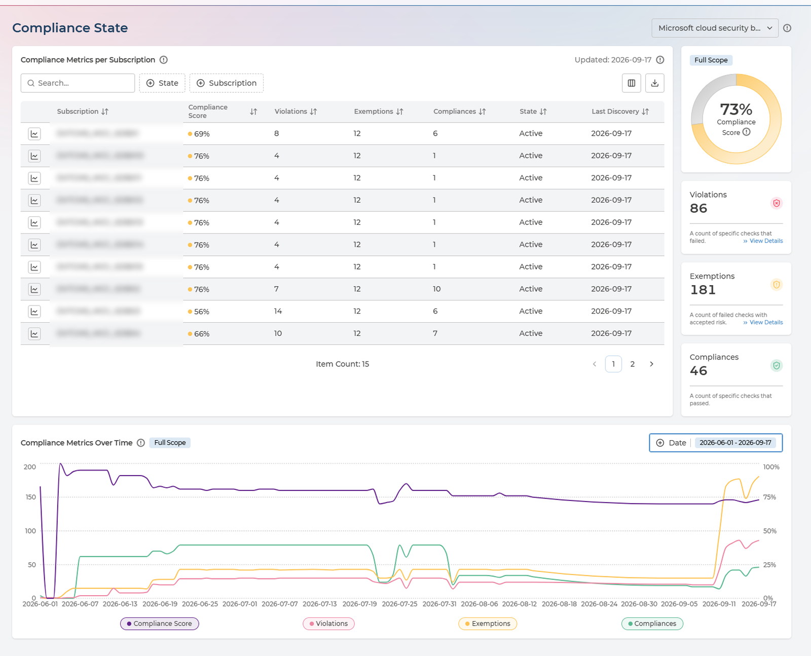
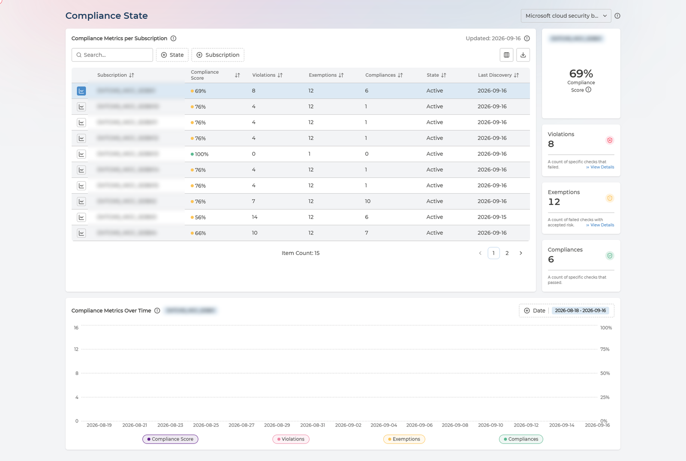
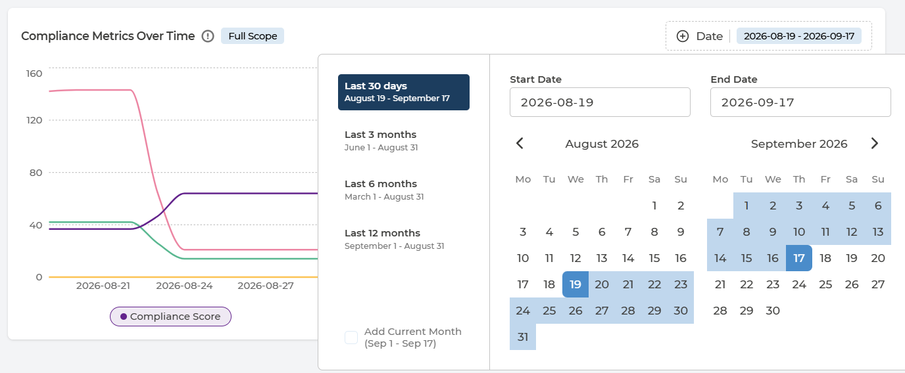

# Compliance State
{: .no_toc }

Compliance State answers the question everyone else asks you: *how compliant are we, and is it getting better?* It scores every subscription against a framework, and plots the same figures day by day so the answer is a trend rather than a snapshot.

<details open markdown="block">
  <summary>
    Table of contents
  </summary>
  {: .text-delta }
- TOC
{:toc}
</details>

---

## What the Page Is For



Three things work together:

- **Compliance Metrics per Subscription** - scores each subscription and counts what is behind the score.
- **The scorecards alongside** - the same figures for whatever scope you have selected, each linking onward to the detail.
- **Compliance Metrics Over Time** - all four figures plotted across a period you choose.

Everything is scoped to one framework, chosen from the selector beside the page title. Switching framework rescores the whole page - a subscription can be strong against one standard and weak against another, which is exactly what this page is for.

---

## Whole Tenant, or One Subscription

This is the control that changes what the page means, and it is easy to miss:

- **Nothing selected** - the scorecards and the chart cover **your whole tenant**. The badge reads **Full Scope**.
- **A subscription row selected** - both narrow to that subscription, and the badge changes to its name.
- **Select the row again** - the selection clears and you are back to the whole tenant.



So the same page serves two audiences without switching views. Leave it unselected for the number you report upwards; select a row when a subscription owner asks about theirs.

Always check the badge before quoting a figure. A tenant-wide score and a single subscription's score look identical on screen and differ completely in meaning.

---

## The Compliance Score

The score is not a judgement. It is arithmetic on three counts:

```
(Compliances + Exemptions) / (Violations + Compliances + Exemptions) x 100%
```

- **Violations** - a count of specific checks that failed.
- **Exemptions** - a count of failed checks with accepted risk.
- **Compliances** - a count of specific checks that passed.

**An exemption counts towards your score exactly as a pass does.** That is deliberate - an accepted risk is a decision your organisation made knowingly, not an outstanding failure. But it means the score alone cannot distinguish an estate that was fixed from one that was exempted, which is why the three counts sit beside it and never appear on their own.

When you report this figure, report the exemption count with it.

### No score is not 0%
{: .no_toc }

A score needs something to have been checked. When nothing has been measured for the framework - for a subscription, or for the whole scope - there is no score, and Pulse shows a yellow **⊘** icon (a circle with a slash) instead of a number, in the score dial, the scorecards and the table:

> Nothing has been measured for this Security Framework yet, so no score can be calculated.

That is different from **0%**, which Pulse shows in red with a full red ring. 0% is a measurement: checks were run and every one of them failed. Do not read the ⊘ icon as either a pass or a failure - nothing was checked.

The same icon marks any count Pulse has no figure for, such as Violations on a subscription that has not been scanned.

---

## Compliance Metrics per Subscription

Each row is one subscription. Work the table by score ascending: the weakest subscription is where remediation effort buys the most.

<details markdown="block" class="reference-box">
  <summary>Every column in the table</summary>

| Column | What it holds | Values |
| --- | --- | --- |
| **Subscription** | The subscription, project or account being scored | Your own names |
| **Provider** | Which cloud it belongs to | AWS · Azure · Google Cloud |
| **Compliance Score** | The score for that subscription, colour-coded | 0–100%, or **⊘** when nothing has been measured |
| **Violations** | Checks that failed | A count, or **⊘** |
| **Exemptions** | Failed checks with accepted risk | A count, or **⊘** |
| **Compliances** | Checks that passed | A count, or **⊘** |
| **State** | Whether the subscription is being scanned, and whether anything is stopping it | **Active** · **Not Active** · **Issues** |
| **Last Discovery** | When Pulse last collected compliance data for it | A date |

Filter by **State** and **Subscription**, or search by name. The table exports to CSV in full - which is the usual way to get these figures into an audit pack or a board report.

</details>

**Last Discovery is the first thing to check when a figure looks wrong.** A score that has not moved may be a score that has not been recollected.

**Not Active** means the subscription is no longer being scanned, so its figures are frozen at the last collection rather than current.

Every subscription connected to Pulse is listed, whether or not compliance data has been collected for it. A subscription with no data shows **⊘** in its figures rather than being left out.

---

## Subscriptions with Issues

**Issues** in the State column means Pulse has no current compliance data for that subscription, and knows why. The badge reads **1 Issue »** or **n Issues »**; click it to open a panel titled with the subscription's name, listing each cause with a code and a description.

| Code | What it means | What to do |
| --- | --- | --- |
| A readiness check code, for example `azure:sub:permissions:missing` | A readiness check that compliance collection depends on has failed - missing permissions, an unregistered resource provider, or a cloud service that is switched off | Use **Open readiness checks** in the panel. It opens the readiness checks in Cloud Onboarding, filtered to that subscription |
| `generic:cred:none` | Pulse has no credentials for this subscription, so it cannot be scanned | Connect it in Cloud Onboarding |
| `mcc:scan:not_found` | Pulse cannot find this subscription (on Google Cloud, this project) | Check that Pulse still has access, or remove it in Cloud Onboarding if it no longer exists |
| `mcc:scan:unknown` | The subscription was not scanned and the cause could not be identified | Contact Devoteam support, quoting the subscription and the code |
| `mcc:standard:not_enabled` | The framework is activated in Pulse but not enabled in your cloud, so it is not assessed | Follow **Learn how to enable Security Framework** in the panel, or see [Enabling Standards in Your Cloud](enabling-standards.md) |

Each entry has a copy control, which copies the code and description together - useful when raising a ticket.

A subscription can show figures and Issues at the same time. That happens when its last successful scan is older than the latest run: the figures and the Last Discovery date are from that older scan, and the Issues badge says why nothing newer has arrived.

---

## Banners at the Top of the Table

Pulse shows one banner at a time above the table when the figures need a caveat. When more than one applies, the first in this list is shown:

| Banner | When it shows |
| --- | --- |
| *No Compliance Metrics collected as no discovery has run for this Security Framework* | The framework is activated in Pulse but not enabled in your cloud. Every subscription is still listed, each with the `mcc:standard:not_enabled` issue |
| *Compliance metrics are more than 30 days old for 1 or more subscriptions. Values shown may not reflect the current cloud state.* | Some subscriptions have issues **and** some data is more than 30 days old |
| *Compliance metrics are not available for 1 or more subscriptions.* | Some subscriptions have issues |
| *The last discovery for 1 or more subscriptions is more than 30 days old. Values shown may not reflect the current cloud state.* | The oldest Last Discovery date in the table is more than 30 days ago |

The two banners about issues carry a **Show subscriptions with Issues** switch. Turn it on to filter the table to the subscriptions with issues; turn it off to see them all again.

**Old data stays visible.** Under the 30-day banner the rows keep their figures - they are still the latest Pulse has, just not recent. Check Last Discovery before quoting them.

### No data collected yet
{: .no_toc }

When the framework is enabled in your cloud but no discovery has recorded results against it, the table is replaced by:

> **No data collected yet**
> The Security Framework is active, but no discovery has recorded results against it. Thus the graph has no data. Data appears after the next scan.

Its **Learn how to enable Security Framework** button opens [Enabling Standards in Your Cloud](enabling-standards.md).

---

## From a Number to the Detail

The **Violations** and **Exemptions** scorecards each carry a **View Details** link, and they are the fastest route out of this page:

| Scorecard | Takes you to |
| --- | --- |
| **Violations** | [Compliance Analysis](compliance-analysis.md), to see which policies are failing and on which assets |
| **Exemptions** | [Exemptions](exemptions.md), to see what has been accepted and when it expires |

That is the intended path through Cloud Compliance: notice a number here, follow it to the detail, act on it in [Remediation Planner](remediation-planner.md).

---

## The Trend



**Compliance Metrics Over Time** plots compliance score, violations, exemptions and compliances together, day by day. Plotting them together is the point - a score moving on its own tells you nothing about why. The chart follows the same scope as the scorecards, so the badge on it tells you whether you are looking at the tenant or one subscription.

Choose the period from the **Date** control:

- **Last 30 days**
- **Last 3 months**
- **Last 6 months**
- **Last 12 months**
- **A custom range**, by setting a start and end date
- **Add Current Month** extends a preset to include the month in progress

Three shapes are worth recognising:

- **Score rises, violations flat, exemptions rise** - risk is being accepted rather than removed. Legitimate, but it should be a decision someone made, not a surprise.
- **Score flat, violations flat, compliances rise** - the estate is growing and new resources are passing. Holding a score while growing is real progress.
- **Score drops sharply on one day** - usually a newly activated framework or a newly onboarded subscription bringing its findings with it, rather than a sudden regression.

When the selected period holds no measured score at all, the chart collapses to its header with the badge **Compliance History Unavailable**. That happens when nothing has been measured yet, and also when the latest data is older than the period you chose - widen the period to see it.

---

## Q&A

### Which framework am I looking at?
{: .no_toc }

The one named in the selector beside the page title. Only activated frameworks appear there - activating them is done in [Policy Manager](policy-manager.md).

### Am I looking at the whole tenant or one subscription?
{: .no_toc }

Check the badge on the scorecards and the chart. **Full Scope** is the whole tenant; anything else is the subscription named on the badge. Clicking the selected row again returns you to Full Scope.

### A subscription shows ⊘ instead of figures
{: .no_toc }

Pulse has no compliance data for it against this framework. Check its State: if it reads **Issues**, open the badge for the cause and what to do. Newly onboarded subscriptions show ⊘ until the first collection completes.

### The score shows ⊘ - is that bad?
{: .no_toc }

Neither good nor bad: nothing has been measured, so there is no score. A measured failure shows as a red **0%**. See [No score is not 0%](#no-score-is-not-0).

### Our score went up but we have not fixed anything
{: .no_toc }

Check the exemptions count over the same period. Exemptions count towards the score as passes do, so approving them raises it without changing the estate.

### Why does the chart show a different figure from the table?
{: .no_toc }

The table shows the latest collection; the chart shows a series over the period you selected. They agree at the right-hand end of the chart, not across it.

### Can I get these figures out of Pulse?
{: .no_toc }

Yes - the metrics table exports to CSV in full, not only the page on screen.
