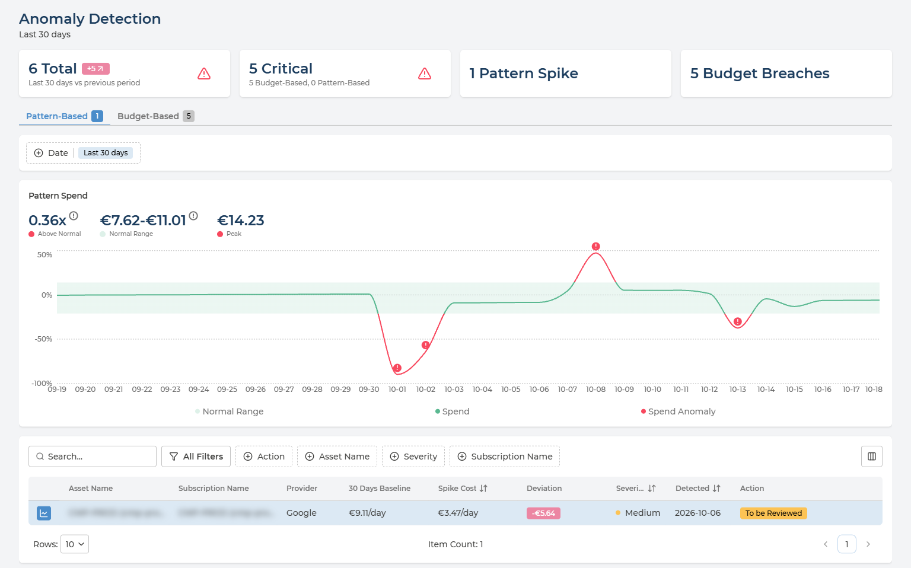
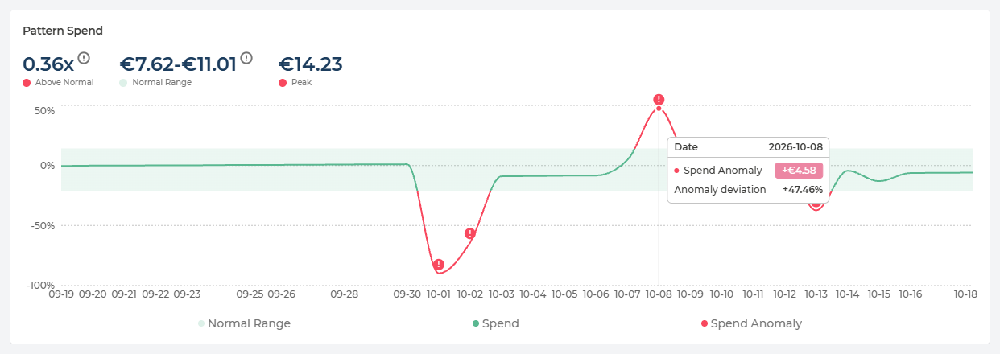
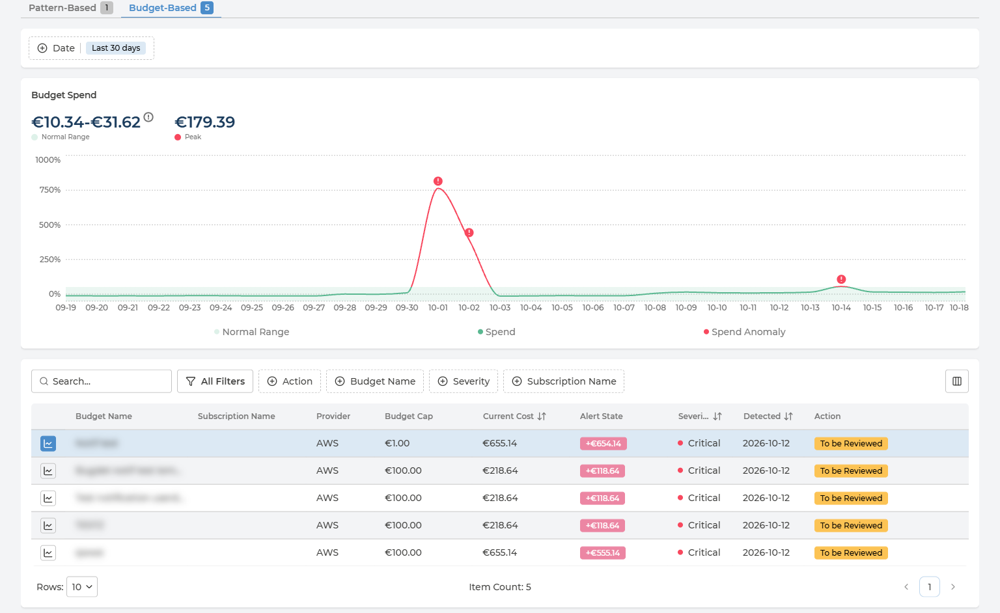

# Anomaly Detection
{: .no_toc }

Anomaly Detection answers the question you want answered before the invoice does: *did something unusual just happen?* It watches daily spend for two kinds of surprise - a day that breaks an asset's normal spending pattern, and spend that has gone over a budget - and lists each one with how far out it was, how severe it is, and whether anyone has reviewed it yet.

  

    Table of contents
  

  {: .text-delta }
- TOC
{:toc}

---

## What the Page Is For

Two kinds of anomaly, one tab for each:

- **Pattern-Based** - a day whose spend falls outside an asset's normal daily range, upwards or downwards. No budget is needed: Pulse works out what normal looks like from the spend itself.
- **Budget-Based** - a budget whose current cost has gone over its cap. These come from your budgets, both those set in Pulse and those read from your cloud - see [Budget & Alerts](budget-alerts.md).

Each tab shows how many anomalies it holds.

Like the rest of Cloud Economics, the page follows the cloud provider, company and currency selected in the header.

---

## The Headline Cards

Four cards above the tabs sum up the period:

| Card | What it counts |
| --- | --- |
| **Total** | Every anomaly detected in the period, with the change against the period before it. In the example, 6 in the last 30 days - 5 more than in the 30 days before |
| **Critical** | Anomalies at **Critical** severity, split into Budget-Based and Pattern-Based |
| **Pattern Spikes** | Anomalies on the Pattern-Based tab |
| **Budget Breaches** | Anomalies on the Budget-Based tab |

**Start with Critical.** Those are the anomalies most likely to need someone today.

---

## Choosing the Period

**Date**, above the chart, sets the period for the cards, both tabs and the list:

- **Last 30 days** - the default.
- **Last 3 months** - the last three full calendar months.
- **A range of your own** - pick a start and an end date in the calendar, up to three months apart.

---

## Reading the Spend Chart

The chart shows one anomaly at a time. Select it with the chart icon at the start of its row in the list; the selected row is highlighted. The selection is kept in the page address, so a link to the page opens on the same anomaly.

**Every day is drawn against a typical day.** The line plots each day's spend as a percentage above or below the typical daily spend, so 0% is an ordinary day:

- **Normal Range** - the shaded band: the daily spend that counts as normal - or, on the Budget-Based tab, spend that stays within the budget.
- **Spend** - the line itself, green while it stays inside the band.
- **Spend Anomaly** - where the line leaves the band it turns red, and each anomalous day is marked with **!**.

Hover any day to see its figures: the date, and how far that day's spend was from normal as an amount. On the Pattern-Based tab, the tooltip adds the **Anomaly deviation** as a percentage; on the Budget-Based tab, the day's **Current Cost** and the **Budget Cap**.

Above the chart, up to three figures summarise the selected anomaly:

| Figure | What it tells you |
| --- | --- |
| **Above Normal** | How far the anomaly is above or below the normal range, as a multiple - for example 0.36x. Pattern-Based only |
| **Normal Range** | The lower and upper limit of normal daily spend. On the Pattern-Based tab it is learnt from the spend itself; on the Budget-Based tab it is set by the budget, with the budget cap as its limit |
| **Peak** | The highest daily spend in the chart |

**How the Normal Range is worked out** depends on the tab:

- **Pattern-Based** - the bounds are calculated with a *leave-one-out* approach: each day is judged against a range calculated from the other days, never including itself. A spike therefore cannot widen its own normal range and hide inside it.
- **Budget-Based** - the range is not learnt from past spend. It comes from the budget: spend is measured against the budget's thresholds, and the budget cap - set either in your cloud or in Pulse - is the limit of the range.

---

## Pattern-Based Anomalies

Each row is one asset whose daily spend broke its pattern.

  
Every column in the Pattern-Based list

| Column | What it holds | Values |
| --- | --- | --- |
| **Asset Name** | The asset whose spend broke its pattern | The asset's own name |
| **Subscription Name** | Where the asset lives. The column takes your provider's term - subscription, account or project | The name and ID |
| **Provider** | Which cloud the asset is in | AWS · Azure · Google Cloud |
| **30 Days Baseline** | The asset's typical daily spend over the last 30 days | An amount per day |
| **Spike Cost** | The daily spend on the anomalous day | An amount per day |
| **Deviation** | Spike Cost minus the baseline - negative when spend fell | An amount |
| **Severity** | How serious the anomaly is | **Low** · **Medium** · **High** · **Critical** |
| **Detected** | When the anomaly was detected | A date |
| **Action** | Where its review stands | See [Reviewing an Anomaly](#reviewing-an-anomaly) |

**A drop is an anomaly too.** In the example, an asset with a baseline of €9.11 a day spent €3.47 - a deviation of -€5.64. Spend that falls without anyone planning it is worth the same look as a spike: it can mean a workload has stopped, failed or moved somewhere it should not have.

---

## Budget-Based Anomalies

Each row is one budget whose current cost has gone over its cap.

  
Every column in the Budget-Based list

| Column | What it holds | Values |
| --- | --- | --- |
| **Budget Name** | The budget that was breached | Your own names |
| **Subscription Name** | The subscription, account or project the budget is set on, where it has one | The name |
| **Provider** | Which cloud the budget belongs to | AWS · Azure · Google Cloud |
| **Budget Cap** | The budget's cap, set either in your cloud or in Pulse | An amount |
| **Current Cost** | Spend so far against that cap | An amount |
| **Alert State** | How far over the cap the budget is: Current Cost minus Budget Cap | An amount, for example +€118.64 |
| **Severity** | How serious the anomaly is | **Low** · **Medium** · **High** · **Critical** |
| **Detected** | When the breach was detected | A date |
| **Action** | Where its review stands | See [Reviewing an Anomaly](#reviewing-an-anomaly) |

**Budget & Alerts warns; Anomaly Detection keeps the record.** [Budget & Alerts](budget-alerts.md) emails the people on a budget's thresholds as spend approaches the cap. Once the cap is passed, the breach is listed here as well, with a review state, so it is not left to someone's inbox.

---

## Filtering the List

The list works the same way on both tabs:

- **Search** across the list.
- **Quick filters** - **Action**, **Asset Name** or **Budget Name**, **Severity** and **Subscription Name**.
- **All Filters** - the same filters, plus **Usage Date**.
- **Sort** by **Spike Cost** or **Current Cost**, **Severity** and **Detected**.
- **Columns** - the button at the right of the filters shows or hides columns.

Filter **Action** on **To be Reviewed** for the anomalies nobody has looked at yet.

---

## Reviewing an Anomaly

Every anomaly carries a review state in the **Action** column:

| State | What it means |
| --- | --- |
| **To be Reviewed** | New - nobody has looked at it yet |
| **Reviewed: Action Taken** | Someone looked at it, and something was done about it |
| **Reviewed: Not Anomaly** | Someone looked at it, and the spend was expected - a planned migration, a load test, a seasonal peak |

**Managers** and **Owners** change the state from the menu at the end of the row, **Change review state**, which lists the other states. Pulse confirms *Status changed successfully*. For every other role, the Action column is read-only. See [User Management](../user-management.md) for the roles.

**Changing the state records a decision; it changes nothing in your cloud.** The resource, the budget and the spend stay exactly as they were.

---

## Nothing Here Changes Your Cloud

**Anomaly Detection reads billing data; it does not act on it.** Nothing on the page stops, resizes or limits a resource, and a budget breach does not stop the spending. What happens next is decided and done in your cloud:

- **On Pulse Premium** - by your own teams. The row says which asset or budget, by how much and since when; [Asset Ownership](../asset-ownership.md) says whose it is.
- **With Managed Cloud Economics** - with Devoteam, as part of the managed service.

---

## Q&A

### Why is a fall in spend listed as an anomaly?
{: .no_toc }

Because it is just as far outside the normal range as a spike. An unplanned drop often means something has stopped working - a scheduled job that no longer runs, a service that failed, traffic that moved elsewhere. If the drop was planned, mark it **Reviewed: Not Anomaly**.

### What does leave-one-out mean?
{: .no_toc }

On the Pattern-Based tab, the normal range for a day is calculated from the other days, never including the day being judged. Without it, a large spike would raise the average it is compared with, and partly hide itself. Budget-Based anomalies do not use it: their range is set by the budget.

### Why can I not change the review state?
{: .no_toc }

Only Managers and Owners can. For every other role, the **Action** column is read-only.

### How is this different from Budget & Alerts?
{: .no_toc }

[Budget & Alerts](budget-alerts.md) is where budgets are set and tracked, and where alert thresholds email people as spend approaches a cap. Anomaly Detection lists the budgets that have gone over their cap, alongside the pattern anomalies that need no budget at all, and keeps track of whether each one has been reviewed.

### Can I send someone a link to a specific anomaly?
{: .no_toc }

Yes. The selected anomaly, the tab and the period are all kept in the page address, so a copied link opens the page on the same view.

### Why is the most recent day missing from the chart?
{: .no_toc }

Anomalies are found in billed daily costs, which arrive within 24 hours of the spend - see [Before the Data Arrives](README.md#before-the-data-arrives). The latest day shown is normally a day or two behind today.
