# Rate Optimisation
{: .no_toc }

Rate Optimisation answers the question that remains once you only run what you need: *are we paying the best rate for it?* It shows how much of your eligible usage your commitments - reservations and savings plans - cover, how much of what you committed to is actually used, and what those commitments save against pay-as-you-go prices.

  

    Table of contents
  

  {: .text-delta }
- TOC
{:toc}

Screenshots on this page show the page content only - the surrounding navigation and header are omitted so each one focuses on the screen being described. Subscription and account names, resource names, customer-specific tag values and anything identifying a person are blurred; figures, service names, regions and dates are shown as they are.
{: .fs-3 }

---

## What the Page Is For

A cloud bill is usage multiplied by rate, and Cloud Economics works on both:

- **Usage** - [Cost Savings](cost-savings.md) finds what to resize, stop or remove.
- **Rate** - Rate Optimisation looks at what you keep running, and whether it is paid for at a committed rate or at the full on-demand price.

The page has four tabs:

| Tab | The question it answers |
| --- | --- |
| **Overview** | How are our commitments doing, at a glance? |
| **Commitments** | What have we committed to, is it used, and what does it cost? |
| **Coverage** | How much of the usage that could be committed is, and what does that save? |
| **Resources** | Which resources run under a commitment, partly, or not at all? |

Like the rest of Cloud Economics, the page follows the cloud provider and currency selected in the header. It covers Azure and AWS; with neither of them selected, the page stays empty. Google Cloud committed use discounts are planned for a future release.

---

## Commitments: Reservations and Savings Plans

Both clouds offer two ways to commit in return for a lower rate than on demand, and the page shows both side by side:

| | Reservation | Savings plan |
| --- | --- | --- |
| **You commit to** | A quantity of a specific resource type (an instance size, a database tier) in a region | An amount of spend per hour, for example €0.065/h |
| **It applies to** | Matching usage only | Eligible compute usage across sizes, regions and services |
| **Shown with** | Its SKU, region and quantity | Its hourly commitment; SKU and region do not apply |

**Reservations apply first; savings plans cover what is left.** This is how both Azure and AWS bill them, and how the page counts them, so the same hour is never counted twice.

On AWS, reservations are Reserved Instances. EC2 Reserved Instances and Savings Plans are the main focus, and commitments for other AWS services are included too.

Two measures decide whether a commitment pays off:

- **Coverage** - how much of the usage that could run under a commitment actually does. Anything outside one is billed at the on-demand rate.
- **Utilisation** - how much of what you committed to is actually used. A commitment is paid for whether it is used or not, so unused commitment is money spent for nothing.

**The two pull in opposite directions.** Commit too little and steady workloads pay on-demand prices; commit too much and you pay for capacity nobody uses. The page puts both side by side so that neither is improved at the expense of the other.

---

## Choosing What to Look At

The bar above the tabs applies to all four:

| Control | What it does |
| --- | --- |
| **Period** | **Last 30 days**, **This month**, **Last month**, **Last 3 months** or **Last 6 months** (the default). Every figure covers this period |
| **Subscription** | Narrows to the subscriptions or accounts where the benefit landed |
| **Service** | Narrows to a service, such as virtual machines or SQL databases |
| **Region** | Narrows to one or more regions |
| **Amortized / Actual** | On the **Commitments** tab only: amortized cost (the purchase spread over the term) or the cash actually paid in the period |
| **Tags** | Not part of this bar. Tag filters and tag breakdowns are on the **Commitments** and **Resources** tabs - see [Filtering and Grouping by Tag](#filtering-and-grouping-by-tag) |

Rate Optimisation can also be filtered by [Asset Group](../asset-ownership.md), to read it for a team or business unit rather than for a subscription or a tag value.

**Cost data as of**, on the right, is the last day with cost data. Cost data arrives one to three days late, so the period ends there rather than today.

---

## Overview

The tab to read first. Across the top:

- **Reservation score** - two rings: **Covered** (the share of eligible usage that runs under a commitment) and **Utilised** (the share of commitments that is used).
- **Cost avoidance: current vs potential** - month by month, what your commitments saved against pay-as-you-go prices (**Current savings**) and what committing at the best available rate per SKU could have saved (**Potential savings**). The total potential for the period sits above the chart. Potential savings is an estimate, not money saved.

Along the bottom:

| Chart | What it shows |
| --- | --- |
| **Used vs purchased** | Committed cost used against committed cost paid in the period. The difference is commitment paid for and not used |
| **Usage by service (h)** | Hours per service, split into hours run under a commitment and hours run on demand |
| **Reserved vs on-demand (h)** | All eligible hours, under a commitment or on demand |

> **Screenshot needed:** The Overview tab in full - the Reservation score rings, the Cost avoidance chart with the period total, and the three charts along the bottom.  
> File: `assets/images/cloud-economics/rate-optimisation-overview.png`

<!-- Replace the placeholder above with: 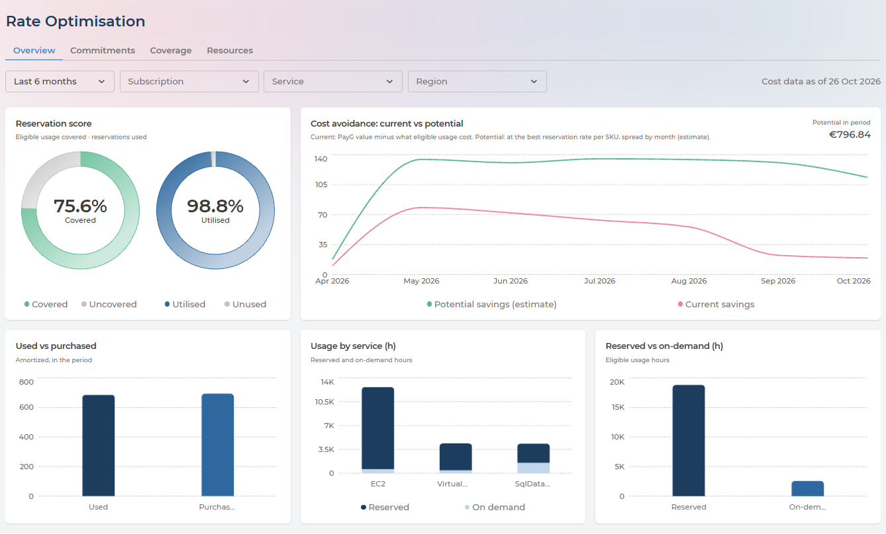 -->

**Read the two rings together:**

| | Low utilisation | High utilisation |
| --- | --- | --- |
| **High coverage** | More is committed than is used. Adjust or let commitments expire before buying more | The goal - most eligible usage is committed, and the commitments are used |
| **Low coverage** | The commitments are in the wrong place: they go unused while eligible usage pays on demand | What is committed works. There is room to commit more |

For example, 98.9% utilised with 75.6% covered means the commitments you hold are fully used, but a quarter of eligible usage still pays on-demand prices - usually because commitments expired and were not renewed.

---

## Commitments

### Key figures

Five cards: **Active reservations** (commitments in force today, savings plans included), **Expiring within 90 days**, **Utilisation (amortized)**, **Unused cost (amortized)** and **Reservation cost** - or **Cash paid** when **Actual** is selected.

### Charts

- **Used vs unused** - monthly committed cost, split into the used and the unused part. With **Actual**, it shows the cash paid each month instead.
- **Utilisation trend** - daily utilisation, weighted by cost, with reference lines at **95%** (target) and **80%** (minimum).
- **Cost by service** - committed cost per service. A savings plan is split across the services where its benefit landed.

> **Screenshot needed:** The top of the Commitments tab - the five cards and the Used vs unused, Utilisation trend (with the 95% and 80% lines) and Cost by service charts.  
> File: `assets/images/cloud-economics/rate-optimisation-commitments.png`

<!-- Replace the placeholder above with: 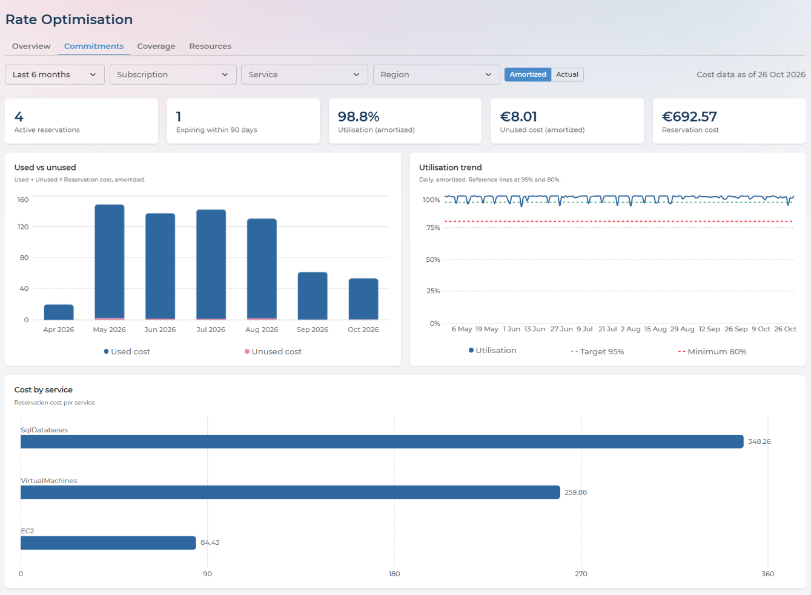 -->

### The commitments table

One row per commitment that is in force today or whose term overlaps the period - expired ones included, so you can see what lapsed. The most unused cost comes first.

| Column | What it shows |
| --- | --- |
| **Name** | The commitment's name, with warnings below it: **Expiring** (ends within 90 days), **Auto-renew off**, **Partial visibility** (shared scope reaching subscriptions not connected to Pulse) |
| **Provider** | Azure or AWS |
| **Type** | Reservation or Savings plan |
| **Service and SKU** | What it covers. For a savings plan, the kind of plan |
| **Region**, **Scope** | Where it applies: a single subscription, shared, regional, an availability zone, a payer account |
| **Term and payment** | 1 or 3 years; monthly, upfront, no upfront, partial upfront |
| **Quantity / commitment** | The reserved quantity, or the savings plan's spend per hour |
| **Ends** | The last day of the term, and the days left - negative once expired |
| **Utilisation** | Green from 95%, amber from 80%, red below |
| **Unused cost**, **Reservation cost** (or **Cash paid**), **Net savings** | For the period |
| **30-day utilisation** | A bar per day; gaps are days without cost |

> **Screenshot needed:** The commitments table with rows that show the Expiring, Auto-renew off and Partial visibility warnings, utilisation in all three colours and the 30-day bars.  
> File: `assets/images/cloud-economics/rate-optimisation-commitments-table.png`

<!-- Replace the placeholder above with: 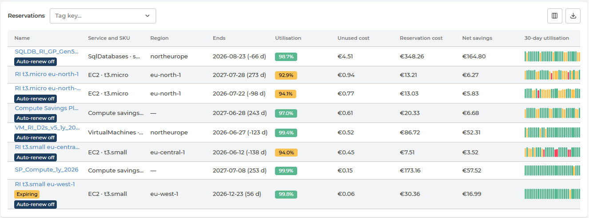 -->

**Tag filter.** Pick a tag key and a value next to the table title to keep only the commitments whose benefit landed on resources carrying that tag - for example `cost-center : finance`. Each row then shows that tag's share of the commitment, based on actual consumption. The cards and charts above stay for the whole selection. See [Filtering and Grouping by Tag](#filtering-and-grouping-by-tag).

> **Screenshot needed:** The tag key and value picker open next to the table title, and the table filtered by one tag - including a shared reservation or savings plan whose row shows only that tag's share.  
> File: `assets/images/cloud-economics/rate-optimisation-tag-filter.png`

<!-- Replace the placeholder above with: 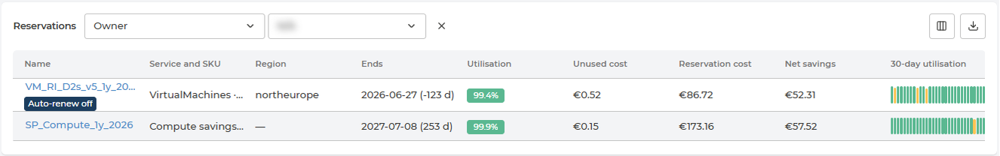 -->

The table exports to CSV.

### Inside a commitment

Click a name to open its panel:

- **Attributes** - type, service, SKU, region, quantity or hourly commitment, term and payment, scope, purchase date, end date, auto-renew, state, where it is billed, cost, unused cost, net savings and utilisation.
- **Daily utilisation** - day by day, with the 95% and 80% lines.
- **Where the benefit landed** - every resource that used the commitment in the period, with its subscription, resource group, region, hours used, cost and saving. Pick a **tag key** to add a column with each resource's value and a one-line summary of shares of actual consumption, such as *Benefit by cost-center: finance 62% · platform 30% · No value 8%*. A resource without a value of its own takes the value of the nearest parent that has one - on Azure its scale set, resource group or subscription; on AWS its account.
- **Payment history** - purchases and refunds in the period.

> **Screenshot needed:** A commitment's panel with a tag key picked under Where the benefit landed - the tag column on each resource and the Benefit by summary line. A savings plan or shared reservation that reached several tag values shows this best.  
> File: `assets/images/cloud-economics/rate-optimisation-benefit-by-tag.png`

<!-- Replace the placeholder above with: 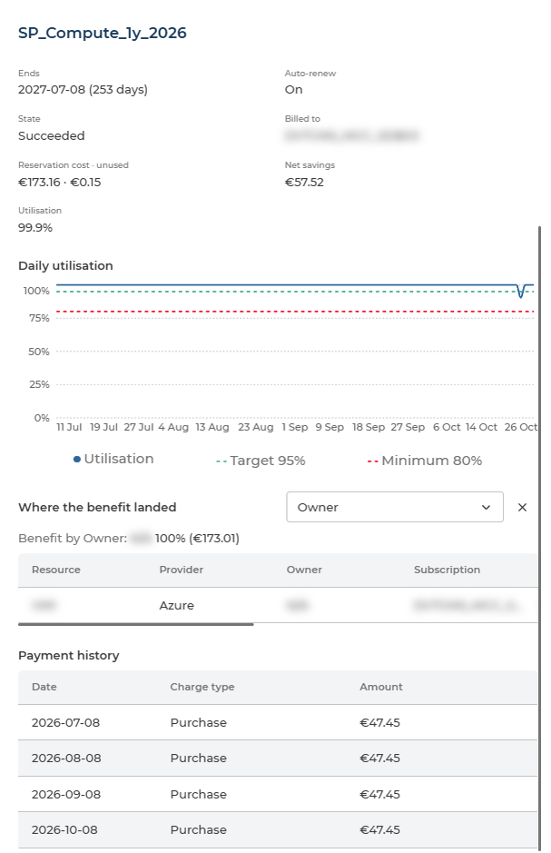 -->

---

## Coverage

Always amortized. Coverage is weighted by pay-as-you-go value: the value of the usage that ran under a commitment, against the value of all usage that could have.

### Key figures

| Card | What it shows |
| --- | --- |
| **Coverage** | Covered pay-as-you-go value as a share of the eligible one |
| **Net savings** | What commitments saved against pay-as-you-go prices, less their unused cost |
| **Effective savings rate** | Net savings as a share of the eligible pay-as-you-go value |
| **Uncovered on-demand spend** | What eligible usage cost at on-demand rates |

A line below the cards says when the commitment prices were last updated, and how many usage rows were left out because the provider reported no pay-as-you-go price for them.

### Charts

- **What you pay vs pay-as-you-go** - monthly, the pay-as-you-go value of eligible usage next to what it actually cost. The gap is the saving.
- **Coverage & utilisation trend** - the two measures month by month. Utilisation that stays high while coverage falls is the typical sign of commitments expiring without renewal.

> **Screenshot needed:** The top of the Coverage tab - the four cards, the line about commitment prices, and the What you pay vs pay-as-you-go and Coverage & utilisation trend charts.  
> File: `assets/images/cloud-economics/rate-optimisation-coverage.png`

<!-- Replace the placeholder above with: 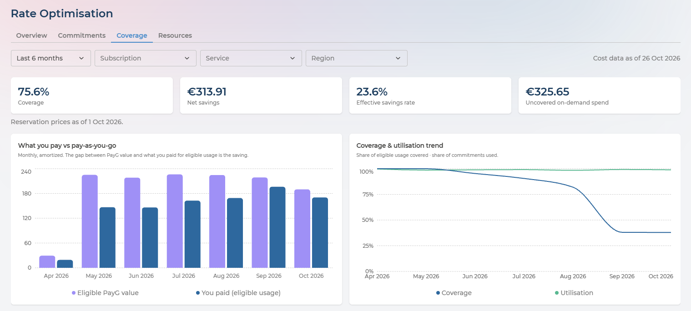 -->

### Coverage by

The same figures split by **Service**, **Subscription**, **Region** or **SKU**, largest eligible value first. Rows with uncovered spend link to the reservation recommendations in [Cost Savings](cost-savings.md).

> **Screenshot needed:** The Coverage by table with its dimension switch, including a row with uncovered spend and its link to Cost Savings.  
> File: `assets/images/cloud-economics/rate-optimisation-coverage-by.png`

<!-- Replace the placeholder above with: 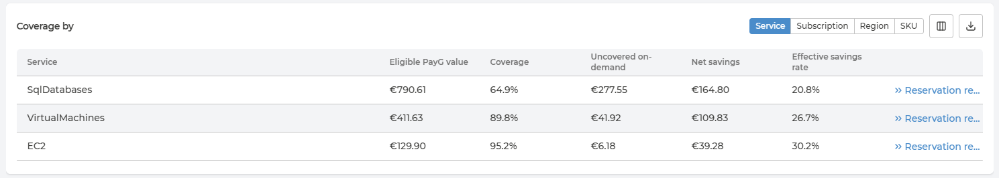 -->

### Effective rate by SKU

What one hour of each SKU really costs:

| Column | What it shows |
| --- | --- |
| **Hours** | Eligible hours of the SKU in the region |
| **PayG rate** | The pay-as-you-go price per hour |
| **Effective rate** | What an hour actually cost, commitments included |
| **Best commitment rate**, **Best term** | The lowest committed rate available for the SKU in the region, and its term |
| **Discount realised** | How far the effective rate sits below the pay-as-you-go rate |

A wide gap between the effective and the best commitment rate is where a new commitment would pay off most.

> **Screenshot needed:** The Effective rate by SKU table, ideally with one SKU showing a wide gap between the effective and the best commitment rate.  
> File: `assets/images/cloud-economics/rate-optimisation-effective-rate.png`

<!-- Replace the placeholder above with: 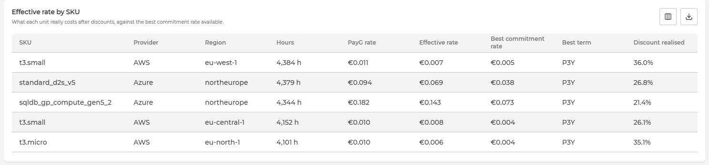 -->

---

## Resources

The same picture, resource by resource: every resource that ran under a commitment or could have.

**Status** sorts them into three:

| Status | Meaning |
| --- | --- |
| **Reserved** | All its eligible usage ran under a commitment |
| **Partly reserved** | Some of it ran on demand |
| **Not reserved** | All of it ran on demand, though a commitment could have covered it |

Filter by status, search by name or resource ID, and pick a **tag key** to add a column and a **Coverage by** table for that tag: per tag value, the resources, reserved and on-demand hours, coverage, reserved cost, uncovered on-demand cost and savings. Coverage here is the reserved share of **hours**, not of pay-as-you-go value, so it can differ slightly from the Coverage tab.

| Column | What it shows |
| --- | --- |
| **Resource**, **Status**, **Provider** | What it is and how it is covered |
| **Subscription**, **Resource group**, **SKU** | Where it is and what size |
| **Reserved**, **On demand** | Hours in the period |
| **Coverage (usage)** | The reserved share of its hours |
| **Savings**, **Total cost** | For the period |

> **Screenshot needed:** The Resources tab with a tag key picked - the status filter, the tag column in the table, and all three statuses visible.  
> File: `assets/images/cloud-economics/rate-optimisation-resources.png`

<!-- Replace the placeholder above with: 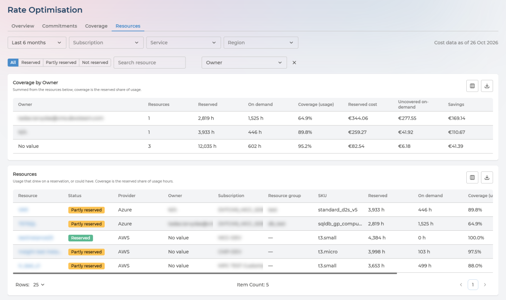 -->

> **Screenshot needed:** The Coverage by table for the picked tag key - per tag value, the resources, reserved and on-demand hours, coverage, reserved cost, uncovered on-demand cost and savings, with a No value row.  
> File: `assets/images/cloud-economics/rate-optimisation-coverage-by-tag.png`

<!-- Replace the placeholder above with: 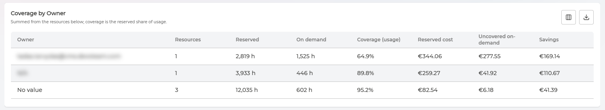 -->

Click a resource to open its panel: its details, its **daily usage** split into hours under a commitment and hours on demand, and the **commitments it used**, each with its hours, cost, saving and the dates it applied. A virtual machine covered first by a reservation and, after it expired, by a savings plan shows both.

> **Screenshot needed:** A resource's panel showing daily usage under a commitment and on demand, and the commitments it used - ideally a VM covered first by a reservation and then by a savings plan.  
> File: `assets/images/cloud-economics/rate-optimisation-resource-panel.png`

<!-- Replace the placeholder above with: 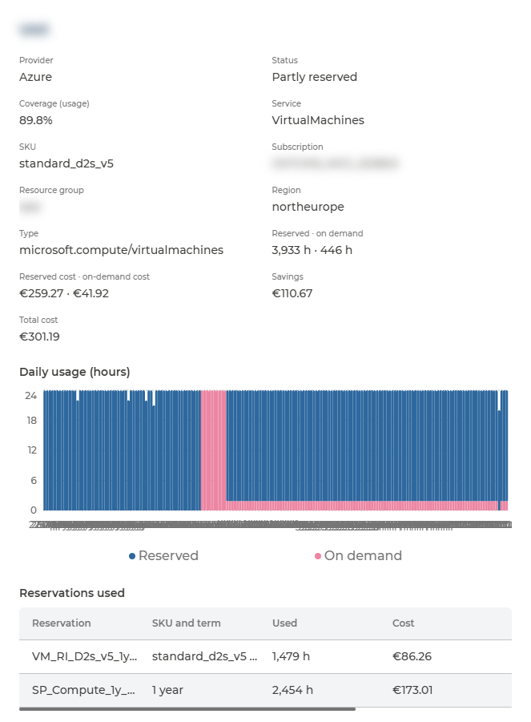 -->

The same figures appear as a **Reservation coverage** card on the resource's own page in [Cloud Inventory](../cloud-inventory.md), and as the **Reservation status** grouping in the Assets **Aggregation** tab.

---

## Filtering and Grouping by Tag

Tags answer who your commitments work for: which cost center, team or application gets the benefit, and which still pays on-demand prices. **Pulse reads tags only from the resources a commitment's benefit landed on**, never from the reservation or savings plan itself.

| Where | What you can do |
| --- | --- |
| **Commitments** tab, the commitments table | Pick a tag key and a value next to the table title to keep only the commitments whose benefit landed on resources carrying that tag, for example `cost-center : finance`. Each row then shows that tag's share of the commitment, based on actual consumption: its cost, savings and unused cost in the same proportion |
| **Commitments** tab, a commitment's panel | Under **Where the benefit landed**, pick a tag key to add a column with each resource's value and a summary of shares of actual consumption, such as *Benefit by cost-center: finance 62% · platform 30% · No value 8%* |
| **Resources** tab | Pick a tag key to add a column and a **Coverage by** table for that tag: per tag value, the resources, reserved and on-demand hours, coverage, reserved cost, uncovered on-demand cost and savings |
| CSV export | The commitments table export includes the tag key and value |

### How a resource gets its tag value
{: .no_toc }

A resource without a value of its own takes the value of the nearest parent that has one: on Azure its scale set, resource group or subscription; on AWS its account. Two labels mark what cannot be given a value:

| Label | Meaning |
| --- | --- |
| **No value** | Neither the resource nor any of its parents has a value for the tag key |
| **No data** | The benefit landed in subscriptions or accounts not connected to Pulse, so their resources and tags cannot be seen. The commitments table marks these commitments **Partial visibility** |

A large **No value** share means part of your commitment benefit cannot be charged back to anyone; tagging the resource group, subscription or account fixes it for every resource below.

### Savings plans and shared reservations
{: .no_toc }

A savings plan, or a reservation with shared scope, can cover many resources at once, often with different tag values. Its benefit is split across them by actual consumption, and its cost and savings follow the same split. The same commitment therefore appears under every tag value it reached, each with its own share.

### Unused commitment
{: .no_toc }

Unused commitment has no resource behind it, so it is shared out across tag values in proportion to their consumption. A cost center that used 62% of a reservation also carries 62% of its unused cost.

### What tags do not change
{: .no_toc }

- The **Overview** tab.
- The cards and charts on the **Commitments** tab. They stay for the whole selection while the table narrows.
- The **Coverage** tab. **Coverage by** splits by Service, Subscription, Region or SKU, not by tag. For coverage per tag value, use the **Coverage by** table on the Resources tab.

Coverage by tag on the Resources tab is the reserved share of **hours**, not of pay-as-you-go value, so it can differ slightly from the Coverage tab.

For example, to see what the finance cost center gets from your commitments: on the Resources tab, pick **cost-center** and read the **finance** row - its coverage, reserved cost, uncovered on-demand cost and savings. To see which commitments serve it and what they cost it, filter the commitments table by `cost-center : finance`; each row shows finance's share of that commitment.

---

## Nothing Here Changes Your Cloud

**Rate Optimisation reads your commitments and usage; it does not buy, change or cancel anything.** Reservations and savings plans are purchased and managed in your cloud provider, and Pulse reports on them from there.

- **On Pulse Premium** - by your own teams, using the page to decide what to commit to and what to renew.
- **With Managed Cloud Economics** - with Devoteam, as part of the managed service.

---

## Q&A

### How is this different from Cost Savings?
{: .no_toc }

[Cost Savings](cost-savings.md) reduces usage - a smaller machine, a stopped resource, a deleted disk. Rate Optimisation reduces the price of the usage that remains. They work best in that order: resize first, then commit to what is left, so you do not commit to capacity you are about to remove.

### Should coverage be 100%?
{: .no_toc }

Usually not. Steady, predictable usage is what commitments suit. Usage that is temporary, seasonal or about to change is often better left on demand, because a commitment keeps costing money after the usage it was bought for has gone.

### Why is utilisation below 100%?
{: .no_toc }

Part of what was committed is not being used. Typically the workload it was bought for has shrunk, moved or been resized, or runs fewer hours - at night or at weekends, for example. The commitment's panel shows on which days, and the **Used vs unused** chart how much it cost.

### Utilisation is high but coverage keeps falling. Why?
{: .no_toc }

Commitments are expiring without being renewed. An expired commitment drops out of utilisation - there is nothing left to measure - but the resources it covered keep running on demand, which lowers coverage. Look for **Auto-renew off** and negative **Ends** values in the commitments table, and for **Not reserved** resources on the Resources tab.

### Reservation or savings plan?
{: .no_toc }

A reservation gives the deeper discount but only for the exact resource type and region. A savings plan gives a smaller discount but follows your usage across sizes, regions and services. Steady workloads that will not change suit reservations; workloads that are steady in spend but change in shape suit savings plans. Because reservations apply first, the two can be combined.

### Can I see what each cost center gets from our commitments?
{: .no_toc }

Yes, through tags. On the Resources tab, pick your cost center tag key: the **Coverage by** table shows, per value, reserved and on-demand hours, coverage, reserved cost and savings. To see which commitments a cost center uses and its share of each, filter the commitments table by that tag. See [Filtering and Grouping by Tag](#filtering-and-grouping-by-tag).

### Why are a commitment's figures lower when I filter by tag?
{: .no_toc }

With a tag filter, each commitment shows only the share consumed by resources carrying that tag: its cost, savings and unused cost in that proportion. Open the commitment and pick the tag key under **Where the benefit landed** to see the full split.

### Who pays for unused commitment?
{: .no_toc }

The resources that used the commitment, in proportion to what they consumed. Unused commitment is shared out across tag values the same way as the benefit, so a cost center that used 62% of a reservation also carries 62% of its unused cost. To keep it low, see [Why is utilisation below 100%?](#why-is-utilisation-below-100)

### Does Pulse use the tags on the reservation or savings plan itself?
{: .no_toc }

No. Pulse uses only the tags of the resources the commitment's benefit landed on, because that shows who the commitment works for.

### What do No value and No data mean?
{: .no_toc }

**No value**: neither the resource nor any of its parents has a value for that tag key. Tagging the resource group, subscription or account gives every resource below it that value. **No data**: the benefit landed in subscriptions or accounts not connected to Pulse, so their resources and tags cannot be seen.

### Is Potential Savings money I will save?
{: .no_toc }

No. It is an estimate of what committing at the best available rate could achieve. Only Current savings and Net savings reflect commitments you already have.

### Why does the period end a few days ago?
{: .no_toc }

Providers deliver cost data one to three days late. **Cost data as of** shows the last complete day, and every period ends there.

### Do I need to add my commitments to Pulse?
{: .no_toc }

No. Reservations and savings plans are bought and managed in your cloud provider, and Rate Optimisation reports on them from there. Nothing needs to be entered in Pulse, and nothing in Pulse changes them.

### Does Rate Optimisation cover Google Cloud?
{: .no_toc }

Not yet. Google Cloud committed use discounts are planned for a future release. Until then the page covers reservations and savings plans on Azure and AWS.
